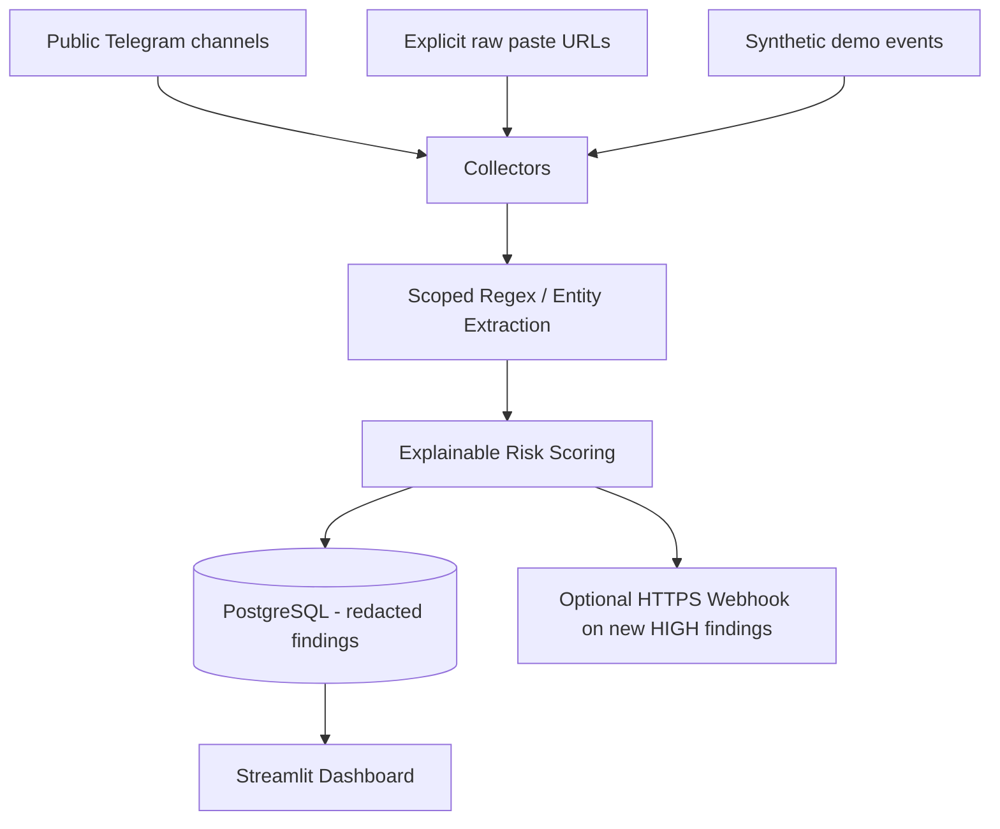

# Architecture

## Explicit constraints

Telegram uses keyword search *within configured public channels*, not Telegram-wide searching. Paste collectors fetch *explicit raw URLs*, not sitewide keyword search or automatic paste discovery. This is a starter that demonstrates ingestion; automated discovery and scheduling are roadmap work.

## Data flow

1. `run_scan.py` starts the enabled collectors.
2. Collectors retrieve text from configured public sources (or synthetic samples).
3. `detector.py` emits target-domain, email, username and document-marker candidates.
4. `risk.py` calculates a transparent heuristic score. This is not validation of a compromise.
5. `pipeline.py` deduplicates using SHA-256 of source and entity identity, and saves masked metadata.
6. `dashboard.py` presents trends and a downloadable redacted CSV.
7. `alerts.py` optionally sends HIGH alerts only once when new findings are inserted.

## Future architecture

Add a scheduler/queue (APScheduler, Celery or cron), authenticated analyst workflow for ownership verification, source provenance/reliability weighting, separate exposure and incident labels, audit trails and retention settings.
